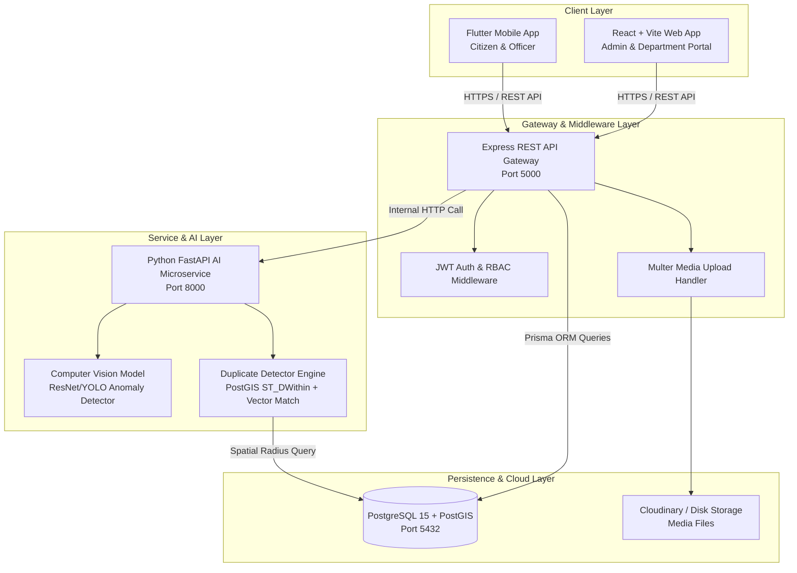

# AVENQRA - Comprehensive System Architecture Blueprint

## System Topology & Microservices Blueprint

AVENQRA employs a multi-tier microservices-inspired architecture that separates user-facing clients (Mobile & Web), API Gateway logic, AI Machine Learning inferencing, and PostgreSQL/PostGIS spatial data persistence.

---

## Service Responsibilities & Protocols

### 1. Client Tier (Mobile & Web)
- **Mobile (Flutter)**: Performs client-side photo capture, native location hardware polling via GPS, state management, and push notification listening.
- **Web Portal (React + Vite)**: Uses Axios with JWT request interceptors to render officer triage queues, GIS spatial heatmaps, SLA progress bars, and department analytics.

### 2. API Gateway Tier (Node.js + Express)
- **Security**: JWT validation, CORS origin verification, Helmet HTTP security headers, and role-based route guard authorization (`CITIZEN`, `OFFICER`, `DEPARTMENT_ADMIN`, `SUPER_ADMIN`).
- **Orchestration**: Manages complaint state transitions (`SUBMITTED` $\rightarrow$ `ASSIGNED` $\rightarrow$ `IN_PROGRESS` $\rightarrow$ `RESOLVED`), writes audit logs, and coordinates async calls to the AI Service.

### 3. AI Inferencing Tier (Python FastAPI)
- **Image Classifier**: Evaluates complaint photos to detect category labels (`Pothole`, `Waste`, `Water Leak`, `Streetlight`) with probability confidence values.
- **Severity Scoring Engine**: Computes visual damage intensity score on a scale of $1.0 - 10.0$.
- **Duplicate Detector**: Performs PostGIS spatial queries (`ST_DWithin`) combined with category match to flag nearby duplicate tickets.

### 4. Data Persistence Tier (PostgreSQL + PostGIS)
- **Relational Tables**: Manages 12 normalized entities (Users, Citizens, Officers, Departments, Complaints, Images, Locations, AI Analysis, Status Logs, Assignments, Notifications, Feedback).
- **Spatial Indexing**: GIST spatial indexes on `GEOMETRY(Point, 4326)` coordinates for millisecond-level location searches.
