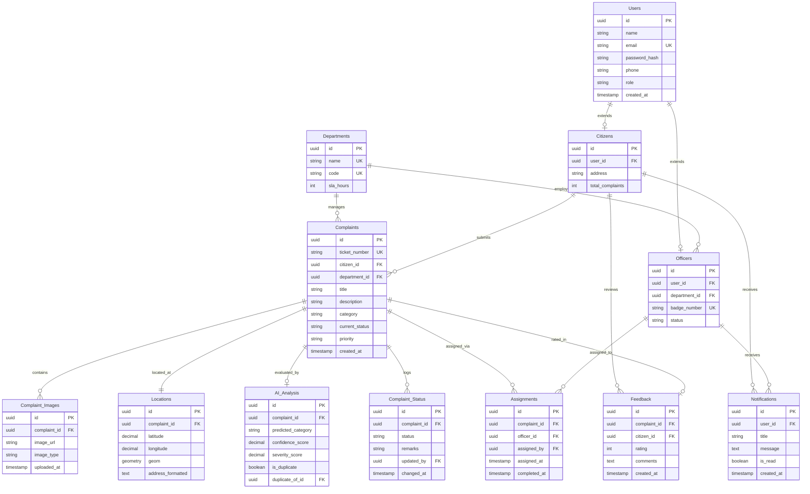

# AVENQRA - 12-Table Entity-Relationship (ER) Schema Documentation

## Database Overview
The database is built on **PostgreSQL 15** with **PostGIS** spatial extension. It utilizes 12 normalized tables to handle authentication, roles (Citizens & Field Officers), municipal department structures, complaint lifecycles, media attachments, geospatial locations, AI computer vision evaluation, dispatch assignments, notifications, and user feedback.

---

## Visual ER Diagram (Mermaid)

---

## Detailed Data Dictionary (12 Tables)

### 1. `Users` (Core Base Table)
| Field | Type | Constraints | Description |
|---|---|---|---|
| `id` | UUID | PK, DEFAULT gen_random_uuid() | Primary key |
| `name` | VARCHAR(100) | NOT NULL | User's full name |
| `email` | VARCHAR(150) | UNIQUE, NOT NULL | Login email address |
| `password_hash` | VARCHAR(255) | NOT NULL | Bcrypt hashed password |
| `phone` | VARCHAR(20) | NULL | Phone contact |
| `role` | VARCHAR(30) | NOT NULL | Enum: CITIZEN, OFFICER, DEPARTMENT_ADMIN, SUPER_ADMIN |
| `created_at` | TIMESTAMP | DEFAULT NOW() | Record creation timestamp |

### 2. `Citizens`
| Field | Type | Constraints | Description |
|---|---|---|---|
| `id` | UUID | PK, DEFAULT gen_random_uuid() | Citizen record ID |
| `user_id` | UUID | FK -> Users(id) ON DELETE CASCADE | Linked user account |
| `address` | TEXT | NULL | Registered address |
| `total_complaints` | INT | DEFAULT 0 | Counter for submitted complaints |

### 3. `Officers`
| Field | Type | Constraints | Description |
|---|---|---|---|
| `id` | UUID | PK, DEFAULT gen_random_uuid() | Field Officer ID |
| `user_id` | UUID | FK -> Users(id) ON DELETE CASCADE | Linked user account |
| `department_id` | UUID | FK -> Departments(id) | Assigned municipal department |
| `badge_number` | VARCHAR(50) | UNIQUE, NOT NULL | Official badge / employee ID |
| `status` | VARCHAR(30) | DEFAULT 'ACTIVE' | ACTIVE, ON_LEAVE, BUSY |

### 4. `Departments`
| Field | Type | Constraints | Description |
|---|---|---|---|
| `id` | UUID | PK, DEFAULT gen_random_uuid() | Department ID |
| `name` | VARCHAR(100) | UNIQUE, NOT NULL | E.g. Roads & Infrastructure |
| `code` | VARCHAR(20) | UNIQUE, NOT NULL | Short code (e.g., ROAD, WATER) |
| `sla_hours` | INT | DEFAULT 48 | Resolution SLA requirement in hours |

### 5. `Complaints`
| Field | Type | Constraints | Description |
|---|---|---|---|
| `id` | UUID | PK, DEFAULT gen_random_uuid() | Primary Complaint ID |
| `ticket_number` | VARCHAR(30) | UNIQUE, NOT NULL | Tracking code (e.g. AVN-2026-891023) |
| `citizen_id` | UUID | FK -> Citizens(id) | Citizen who filed the complaint |
| `department_id` | UUID | FK -> Departments(id) | Target municipal department |
| `title` | VARCHAR(200) | NOT NULL | Issue title |
| `description` | TEXT | NOT NULL | Detailed problem description |
| `category` | VARCHAR(50) | NOT NULL | Category (e.g. POTHOLE, WASTE) |
| `current_status` | VARCHAR(30) | DEFAULT 'SUBMITTED' | SUBMITTED, ASSIGNED, IN_PROGRESS, RESOLVED, REJECTED |
| `priority` | VARCHAR(20) | DEFAULT 'MEDIUM' | LOW, MEDIUM, HIGH, CRITICAL |
| `created_at` | TIMESTAMP | DEFAULT NOW() | Timestamp filed |

### 6. `Complaint_Images`
| Field | Type | Constraints | Description |
|---|---|---|---|
| `id` | UUID | PK, DEFAULT gen_random_uuid() | Image ID |
| `complaint_id` | UUID | FK -> Complaints(id) ON DELETE CASCADE | Parent complaint |
| `image_url` | TEXT | NOT NULL | Cloudinary or local media URL |
| `image_type` | VARCHAR(30) | DEFAULT 'INITIAL' | INITIAL, RESOLUTION_PROOF |
| `uploaded_at` | TIMESTAMP | DEFAULT NOW() | Upload timestamp |

### 7. `Locations`
| Field | Type | Constraints | Description |
|---|---|---|---|
| `id` | UUID | PK, DEFAULT gen_random_uuid() | Location record ID |
| `complaint_id` | UUID | FK -> Complaints(id) ON DELETE CASCADE | Associated complaint |
| `latitude` | DECIMAL(10,8) | NOT NULL | Latitude coordinate |
| `longitude` | DECIMAL(11,8) | NOT NULL | Longitude coordinate |
| `geom` | GEOMETRY(Point, 4326) | NOT NULL | PostGIS Spatial Point geometry |
| `address_formatted` | TEXT | NULL | Reverse-geocoded street address |

### 8. `AI_Analysis`
| Field | Type | Constraints | Description |
|---|---|---|---|
| `id` | UUID | PK, DEFAULT gen_random_uuid() | Analysis ID |
| `complaint_id` | UUID | FK -> Complaints(id) ON DELETE CASCADE | Evaluated complaint |
| `predicted_category` | VARCHAR(50) | NOT NULL | AI predicted category |
| `confidence_score` | DECIMAL(5,4) | NOT NULL | Model confidence (0.0000 - 1.0000) |
| `severity_score` | DECIMAL(4,2) | NOT NULL | Anomaly severity (1.00 - 10.00) |
| `is_duplicate` | BOOLEAN | DEFAULT FALSE | Duplicate flag |
| `duplicate_of_id` | UUID | FK -> Complaints(id) | Reference to master ticket if duplicate |

### 9. `Complaint_Status` (Status Audit Logs)
| Field | Type | Constraints | Description |
|---|---|---|---|
| `id` | UUID | PK, DEFAULT gen_random_uuid() | Status Log ID |
| `complaint_id` | UUID | FK -> Complaints(id) ON DELETE CASCADE | Linked complaint |
| `status` | VARCHAR(30) | NOT NULL | Transitioned status |
| `remarks` | TEXT | NULL | Officer/Admin notes |
| `updated_by` | UUID | FK -> Users(id) | Modifier user ID |
| `changed_at` | TIMESTAMP | DEFAULT NOW() | Transition timestamp |

### 10. `Assignments`
| Field | Type | Constraints | Description |
|---|---|---|---|
| `id` | UUID | PK, DEFAULT gen_random_uuid() | Assignment ID |
| `complaint_id` | UUID | FK -> Complaints(id) | Targeted complaint |
| `officer_id` | UUID | FK -> Officers(id) | Dispatched officer |
| `assigned_by` | UUID | FK -> Users(id) | Admin who dispatched |
| `assigned_at` | TIMESTAMP | DEFAULT NOW() | Dispatch timestamp |
| `completed_at` | TIMESTAMP | NULL | Completion timestamp |

### 11. `Notifications`
| Field | Type | Constraints | Description |
|---|---|---|---|
| `id` | UUID | PK, DEFAULT gen_random_uuid() | Notification ID |
| `user_id` | UUID | FK -> Users(id) ON DELETE CASCADE | Recipient user |
| `title` | VARCHAR(150) | NOT NULL | Notification title |
| `message` | TEXT | NOT NULL | Notification body |
| `is_read` | BOOLEAN | DEFAULT FALSE | Read indicator |
| `created_at` | TIMESTAMP | DEFAULT NOW() | Delivery timestamp |

### 12. `Feedback`
| Field | Type | Constraints | Description |
|---|---|---|---|
| `id` | UUID | PK, DEFAULT gen_random_uuid() | Feedback ID |
| `complaint_id` | UUID | FK -> Complaints(id) ON DELETE CASCADE | Resolved complaint |
| `citizen_id` | UUID | FK -> Citizens(id) | Submitting citizen |
| `rating` | INT | CHECK (rating BETWEEN 1 AND 5) | Star rating (1 to 5) |
| `comments` | TEXT | NULL | Citizen feedback review |
| `created_at` | TIMESTAMP | DEFAULT NOW() | Submission timestamp |
