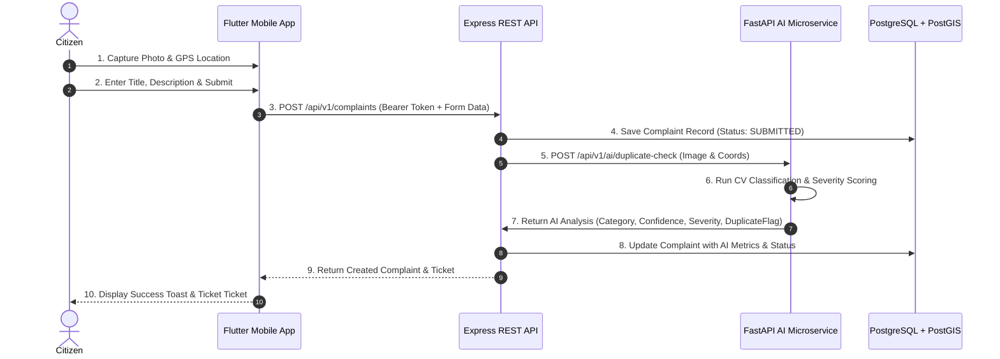
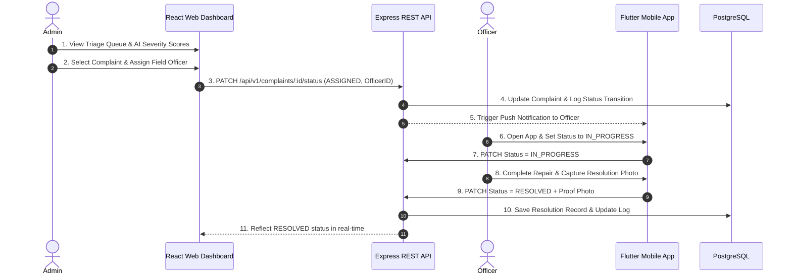

# AVENQRA - Detailed Use Cases & User Flows

This document details the primary Use Cases and User Flow Sequence Diagrams for the three core actors in the system: **Citizens**, **Field Officers**, and **Department Administrators**.

---

## 1. Actor Definitions

- **Citizen**: Public user who reports infrastructure issues, monitors status updates, and provides feedback.
- **Field Officer**: Municipal worker dispatched to inspect and resolve assigned civic complaints.
- **Department Admin**: Administrator responsible for managing department complaints, assigning field officers, and monitoring SLA performance.

---

## 2. Detailed Use Case Specifications

### UC-01: Citizen Registration & Login
- **Actor**: Citizen
- **Preconditions**: Citizen opens the mobile application.
- **Main Flow**:
  1. User selects "Register" and inputs name, email, phone, and password.
  2. Mobile app submits POST request to `/api/v1/auth/register`.
  3. API verifies email uniqueness, hashes password, saves user record, and returns a signed JWT.
  4. Mobile app stores JWT securely in `FlutterSecureStorage` and navigates to `HomeScreen`.
- **Alternative Flow (Login)**: Existing user enters credentials at `/api/v1/auth/login` to retrieve JWT.

---

### UC-02: Submit Geotagged Complaint
- **Actor**: Citizen
- **Preconditions**: User is logged in.
- **Main Flow**:
  1. Citizen taps "Report New Issue".
  2. Citizen captures a photo using device camera.
  3. App acquires current GPS coordinates (`latitude`, `longitude`) via `Geolocator`.
  4. Citizen selects issue category and enters description.
  5. App submits multipart form request to POST `/api/v1/complaints`.
  6. Backend stores complaint, triggers AI analysis asynchronously, generates ticket number (`AVN-XXXXXX`), and returns confirmation to mobile app.

---

### UC-03: AI Category Classification & Duplicate Check
- **Actor**: AI Microservice (System)
- **Preconditions**: Backend receives a new complaint submission.
- **Main Flow**:
  1. Backend sends image payload and GPS coordinates to AI Service (`POST /api/v1/ai/duplicate-check`).
  2. AI Service runs model inference to classify issue (e.g., Pothole, 94% confidence) and calculates severity score.
  3. AI Service executes spatial radius query against existing active complaints.
  4. If a duplicate exists within 50m, AI Service flags `isDuplicate = true`.
  5. AI Service returns evaluation payload back to Backend REST Gateway.

---

### UC-04: Admin Complaint Triage & Officer Dispatch
- **Actor**: Department Admin
- **Preconditions**: Admin is logged in to the Web Dashboard.
- **Main Flow**:
  1. Admin opens Complaints Triage view.
  2. System lists complaints sorted by priority and AI severity score.
  3. Admin views complaint details, photo, and geolocation on interactive map.
  4. Admin selects an active Field Officer from dropdown and clicks "Assign Officer".
  5. System updates complaint status to `ASSIGNED` and sends push notification to assigned officer.

---

### UC-05: Field Officer Resolution & Work Proof Upload
- **Actor**: Field Officer
- **Preconditions**: Officer has assigned tasks in mobile app.
- **Main Flow**:
  1. Officer views assigned task list on mobile map interface.
  2. Officer updates status to `IN_PROGRESS` upon arriving at location.
  3. After completing repair work, officer captures a resolution proof photo.
  4. Officer taps "Mark as Resolved".
  5. Backend updates complaint status to `RESOLVED`, logs timestamp, and notifies submitting Citizen.

---

## 3. User Flow Sequence Diagrams

### 3.1 Citizen Issue Reporting & AI Analysis Flow

---

### 3.2 Officer Dispatch & Resolution Flow

